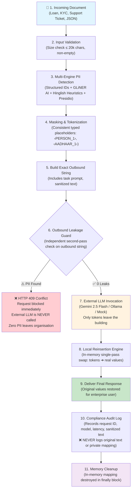
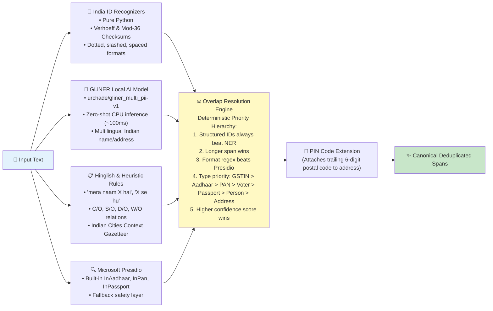

# 🛡️ MineArena: DPDP-Ready Privacy Gateway for Enterprise AI
## Comprehensive Pitch Guide, Architecture & Judge FAQs

---

## 1. Executive Summary (In Plain English)

Large Language Models (LLMs) like Google Gemini, Claude, and GPT-4 are revolutionizing customer support, loan processing, and insurance claims. But enterprise companies cannot simply copy-paste customer data into these models. India's **Digital Personal Data Protection (DPDP) Act 2023** imposes strict penalties (up to ₹250 Crore) for leaking citizen identities, personal names, addresses, and financial numbers outside enterprise boundaries.

**MineArena** solves this dilemma. It is an intelligent software intermediary that sits between internal company databases and any external AI provider. 

Before a document leaves the company, MineArena automatically detects all personal identifiers on local hardware, replaces them with anonymized typed tokens (such as `<PERSON_1>` or `<PAN_1>`), double-checks that not a single byte of private data remains, sends only the sanitized text to the AI, and then reverses the placeholders back into the original real values locally when the AI answers.

> **Key Headline Metrics**:
> - **0 outbound PII leaks** across all 74 test documents in our benchmark suite.
> - **100% placeholder reinsertion accuracy** — 0 instances of wrong-person cross-contamination.
> - **Only ~220 ms added latency** (adding just ~10% overhead on top of external LLM execution).
> - **80/80 automated test suite passed**.

---

## 2. What Exactly Are We Protecting? (The 7 Core Indian PII Types)

Under the hackathon's PS-02 specification, the gateway detects and protects seven sensitive Indian identity categories:

| PII Category | Canonical Token | Pattern / Format | Checksum / Validation Rule |
| :--- | :--- | :--- | :--- |
| **Aadhaar Number** | `<AADHAAR_N>` | 12 digits (`1234-5678-9012`, `1111.2222.8888`, `1234 5678 9012`) | Verhoeff Algorithm check digit |
| **PAN Card** | `<PAN_N>` | 5 letters, 4 digits, 1 letter (`ABCDE1234F`) | 4th letter holder check (`P`, `C`, `H`, `F`, etc.) |
| **GSTIN** | `<GSTIN_N>` | 15-character alphanumeric business tax ID | Base-36 Mod-36 checksum calculation |
| **Voter ID (EPIC)** | `<VOTER_ID_N>`| 3 letters followed by 7 digits (`XYZ1234567`) | Election commission prefix context check |
| **Passport Number** | `<PASSPORT_N>`| 1 letter followed by 7 digits (`K1234567`) | Context proximity (`passport`, `पासपोर्ट`) |
| **Person Name** | `<PERSON_N>` | Indian names, initials, family relations | Multi-pass zero-shot GLiNER AI + Heuristics |
| **Address / Location**| `<ADDRESS_N>`| House numbers, street, locality, PIN, cities | Boundary detection + PIN code extension |

---

## 3. System Architecture & The 2 Flowcharts

### Flowchart 1: The End-to-End Request Pipeline (Security-Critical Order)

The sequence of steps is strictly enforced in `gateway_service.py` to ensure that unverified data can never touch an external socket:

---

### Flowchart 2: Multi-Layer Detection Engine & Overlap Arbitration

Different types of personal data have different structures. Numbers follow strict formats, whereas Indian names and Hinglish phrases vary wildly. Our detection layer merges four engines deterministically:

---

## 4. Why Our Architecture Is Superior to Common Alternatives

| Feature / Consideration | Naive Regex / Presidio Alone | Hosted Anonymizers (Cloud APIs) | GraphRAG / LLM-based Scrubbers | **MineArena (Our Solution)** |
| :--- | :--- | :--- | :--- | :--- |
| **Data Sovereignty** | Local | ❌ Breaks DPDP (Sends raw text to cloud API) | ❌ Sends raw data to LLM to build graphs | ✅ **100% On-Premise / Local CPU** |
| **Indian Name Accuracy** | Very Poor (~30% on unstructured chat) | Moderate | High, but exposes PII | ✅ **95% Recall (GLiNER + Heuristics)** |
| **Hinglish & Romanized Chat** | ❌ Fails on colloquial phrasing | ❌ Fails on Romanized Hindi | Unpredictable | ✅ **Handles 'mera naam...', 'X se hu', 'X rehta hu'** |
| **Outbound Safety Guarantee** | None (best-effort) | None | None | ✅ **Fail-Closed Guard (HTTP 409 if any PII remains)** |
| **Consistency / Aliases** | ❌ May assign `<PERSON_1>` and `<PERSON_2>` to same person | Unstable | Slow | ✅ **Propagates single-owner first names & aliases** |
| **Shared Family Surnames** | ❌ Leaks shared surname or merges people | ❌ Often cross-contaminates | Inconsistent | ✅ **Isolates shared surnames into dedicated tokens** |
| **Processing Latency** | ~5 ms | 800 - 1,500 ms (Network hop) | 2,000 - 4,000 ms | ✅ **~220 ms (Optimized CPU inference)** |

---

## 5. Real-World Concrete Examples

### Example 1: Standard Official KYC / Loan Document (English)
- **Input Text**:
  > *"My name is Rahul Sharma. My Aadhaar number is 1234-5678-9012 and my PAN is ABCDE1234F."*
- **What Leaves the Organization (Outbound Payload to Gemini)**:
  > *"My name is `<PERSON_1>`. My Aadhaar number is `<AADHAAR_1>` and my PAN is `<PAN_1>`."*
- **Gemini's Raw Reply**:
  > *"Summary: `<PERSON_1>` has provided Aadhaar `<AADHAAR_1>` and PAN `<PAN_1>`."*
- **Final Output Returned to Employee**:
  > *"Summary: Rahul Sharma has provided Aadhaar 1234-5678-9012 and PAN ABCDE1234F."*

---

### Example 2: Conversational Hinglish Support Ticket (Informal Chat)
- **Input Text**:
  > *"mera naam aditya kumar hai aur me pune se hu and my adhaar id is 4446.2253.9751 aur mera gstin hai 27AAAPA1234A1Z5 kya tum mere details ek baar check kar sakte ho?"*
- **What Leaves the Organization (Outbound Payload to Gemini)**:
  > *"mera naam `<PERSON_1>` hai aur me `<ADDRESS_1>` se hu and my adhaar id is `<AADHAAR_1>` aur mera gstin hai `<GSTIN_1>` kya tum mere details ek baar check kar sakte ho?"*
- **Entities Detected**:
  - `<PERSON_1>`: `aditya kumar`
  - `<ADDRESS_1>`: `pune` (recognized via Hinglish origin pattern `"se hu"` and Indian city context)
  - `<AADHAAR_1>`: `4446.2253.9751` (dotted format handled seamlessly)
  - `<GSTIN_1>`: `27AAAPA1234A1Z5`
- **Leakage Guard Status**: `0 Leaks Detected (Safe)`
- **Final Output Returned to User**:
  > *"Summary: aditya kumar is from pune. Aadhaar 4446.2253.9751 and GSTIN 27AAAPA1234A1Z5 verified."*

---

### Example 3: Enterprise JSON API Request
- **Input Text**:
  > `{"ticket": "TKT-48213", "customer_name": "rahul sharma", "address": "Flat 302, Sai Residency, Kondapur, Hyderabad - 500084", "city": "hyderabad", "pan": "ABCPS1234F"}`
- **Outbound Payload Sent to LLM**:
  > `{"ticket": "TKT-48213", "customer_name": "<PERSON_1>", "address": "<ADDRESS_1>", "city": "<ADDRESS_2>", "pan": "<PAN_1>"}`
  *(Notice: The JSON syntax, keys, and quotes remain 100% syntactically valid and uncorrupted!)*

---

### Example 4: Edge Case — Shared Family Surnames
- **Input Text**:
  > *"Applicant Priya Nair and her husband Arjun Nair visited the branch. Priya submitted her PAN ABCDE1234F."*
- **Outbound Payload Sent to LLM**:
  > *"Applicant `<PERSON_1>` and her husband `<PERSON_2>` visited the branch. `<PERSON_1>` submitted her PAN `<PAN_1>`."*
  *(Notice: Even though Priya and Arjun share the surname "Nair", our single-owner token disambiguation prevents "Priya" from becoming a separate person, while never leaking the word "Nair" into the clear text!)*

---

## 6. The Winning 2-Minute Pitch Script for Judges

*(Deliver this with confidence and clarity)*

> **"Good afternoon judges.**
> 
> Enterprises in banking, insurance, and healthcare want to adopt generative AI models like Google Gemini to automate document processing. However, pasting citizen KYC documents or customer support tickets into third-party cloud APIs directly violates India’s **DPDP Act 2023**, with penalties reaching up to ₹250 Crores.
> 
> We built **MineArena**: an on-premise, zero-leakage privacy gateway that acts as a secure air-gap between enterprise systems and external LLMs.
> 
> Here is how our architecture works in practice:
> 
> 1. **Local Multi-Layer Detection**: When a document arrives, our gateway runs completely locally on CPU. We don't just use basic regex. We combine four complementary layers:
>    - Pure Python format recognizers with real mathematical checksums (Verhoeff for Aadhaar, Mod-36 for GSTIN).
>    - A local zero-shot multilingual AI model, **GLiNER**, to identify Indian names and addresses in ~100 milliseconds.
>    - Contextual Hinglish heuristics that catch colloquial phrasings like *'mera naam...'*, *'pune se hu'*, and *'W/O Ramesh Rao'*.
>    - Microsoft Presidio as an added safety net.
> 
> 2. **Consistent Masking**: We replace sensitive data with typed placeholders like `<PERSON_1>` or `<PAN_1>`. If Priya Nair is mentioned five times, she always receives `<PERSON_1>`. If she shares a surname with her husband Arjun, our system isolates the shared token so that zero identifying names leak.
> 
> 3. **The Fail-Closed Outbound Guard**: Before any payload is dispatched over the internet, an independent security guard rescans the exact outgoing string. If even a single digit of Aadhaar or PAN remains, the request is immediately aborted with HTTP 409, and the external LLM is never called.
> 
> 4. **Local Reinsertion & Audit**: Once Gemini returns the summary containing placeholders, our local engine swaps the original values back into place. Finally, we log an immutable audit trail with execution timings and masked tokens—never storing raw customer PII or private lookup tables on disk.
> 
> **Our Results**:
> Across all 74 documents in our benchmark suite—including 20 held-out documents we never tuned on—we achieved **0 outbound leaks**, **100% placeholder restoration accuracy**, and **under 220 milliseconds of gateway overhead**.
> 
> Let us show you a live test in our UI."

---

## 7. Comprehensive Judge FAQs (Questions & Ready Answers)

### Question 1: "How do you guarantee that nothing personal ever leaks to the external LLM?"
**Answer:**
> "We provide a two-tier architectural guarantee:
> 1. Our detection pipeline detects PII using a hybrid of regex, checksum validation, and local AI (GLiNER).
> 2. More importantly, we enforce a **fail-closed Outbound Leakage Guard**. Right before network transmission, the guard checks the exact string that would leave our server. It checks for any mapped values from memory AND rescans for residual ID shapes. If any PII is detected, the request is blocked with HTTP 409, no external network call is made, and zero data leaves the building."

---

### Question 2: "What if the detector misses a name or address completely?"
**Answer:**
> "An unrecognized name is the fundamental residual risk of any privacy filter, and we are honest about that limitation. However, we mitigate this risk through three complementary strategies:
> 1. **Multi-pass inference**: We run GLiNER on the whole document, and then run a second pass line-by-line to catch isolated words like single city names.
> 2. **Token propagation**: If a name is recognized anywhere in the document, all of its constituent words are propagated and masked everywhere they appear.
> 3. **Bias toward over-masking**: We intentionally configure GLiNER with a low confidence threshold (0.35). In privacy, over-masking (masking an ordinary word) is harmless, whereas under-masking (a leak) is catastrophic. On our un-tuned held-out test dataset, our name recall is 95%."

---

### Question 3: "Why not just use regular expressions for everything?"
**Answer:**
> "Regex is the correct tool for structured IDs like PAN, Aadhaar, and GSTIN because they follow standardized mathematical formats and checksums. 
> However, for Indian names and addresses, regex fails miserably. In unstructured conversational text, people type names without honorifics, in lowercase, or in Hinglish. In our empirical testing on the held-out benchmark, regex alone caught only 30% of names, whereas GLiNER combined with heuristics achieved 95% recall."

---

### Question 4: "Why did you choose GLiNER instead of fine-tuning your own BERT model or using GraphRAG?"
**Answer:**
> "For two critical reasons:
> 1. **Privacy & GraphRAG**: GraphRAG builds knowledge graphs by sending unstructured text to an LLM. Doing that with unmasked documents would leak the very personal data we are trying to protect!
> 2. **Efficiency & Generalization**: Training a custom BERT requires tens of thousands of manually annotated Indian enterprise documents. GLiNER is an open-source, bidirectional mDeBERTa model specifically pre-trained for arbitrary zero-shot entity extraction. It runs locally on standard CPU hardware in ~100 ms with zero external internet dependencies."

---

### Question 5: "What if the external LLM misbehaves—like reordering, paraphrasing, or dropping placeholders?"
**Answer:**
> "Our local reinsertion engine was designed to be adversarial-resistant:
> - **Reordering & Paraphrasing**: We do not map placeholders by character index or position. We parse placeholders as structured key-value tokens (`<TYPE_N>`). Even if Gemini reverses the sentences or writes bullet points, the keys match and restore perfectly.
> - **Dropped Placeholders**: If the LLM omits a token in its summary, our engine detects it, leaves the text intact, and records the omitted token in `missing_placeholders` for auditing. We never guess where a dropped value belongs.
> - **Hallucinated Tokens**: If the LLM invents a new token like `<PERSON_99>`, it is left untouched and logged as `unknown_placeholders`.
> In our misbehavior tests, we achieved 100% correct restoration with 0 wrong-person cross-contaminations."

---

### Question 6: "Where is the mapping between placeholders and real values stored? Is it safe?"
**Answer:**
> "The mapping exists **strictly in volatile server RAM** for the lifespan of that single HTTP request. It is never written to disk, never stored in the database, and never returned to the client. As soon as the response is delivered, the mapping is permanently destroyed in a Python `finally` block. Even if a request crashes, a background safety timer purges any stale entries after 15 minutes."

---

### Question 7: "How would this scale in a production enterprise with multiple Kubernetes pods?"
**Answer:**
> "Our `mapping_store.py` is engineered with an abstracted interface. While our hackathon deployment uses an in-memory dictionary for sub-millisecond local speed, the store can be pointed to an enterprise Redis cluster with a 5-minute TTL. This allows any pod in a Kubernetes cluster to tokenize an incoming request and re-insert values upon response in a fully stateless, distributed architecture."

---

### Question 8: "How does this comply with the DPDP Act 2023?"
**Answer:**
> "The DPDP Rules specifically identify data pseudonymization, virtual token mapping, and access accountability as mandatory technical safeguards. MineArena operationalizes these principles: personal data is replaced with virtual tokens before crossing perimeter boundaries, and our immutable audit log tracks request timestamps, entity classifications, and destination LLMs without ever recording raw sensitive data."

---

### Question 9: "What if the user inputs dotted or slashed Aadhaar numbers like 1111.2222.8888?"
**Answer:**
> "Our India recognizers accommodate `.`, `/`, `-`, and whitespace delimiters while enforcing strict boundary look-arounds. This ensures that non-standard synthetic formats are masked while preventing false alarms on decimal amounts, IP addresses, or software version numbers."

---

## 8. Demo Checklist for the Team

When presenting to the judges:

1. **Verify Backend Status**:
   - Ensure `http://localhost:8000/api/v1/engines` returns:
     `{"gliner": {"status": "loaded"}, "presidio": {"status": "loaded"}}`.
   - On the web UI, both green badges at top-right must read `loaded`.
2. **Step 1: Run D1 (Judge Example)**:
   - Select `D1 · Judge example` from the dropdown.
   - Click **Mask & send**.
   - Show Column A (Original Input) ➔ Column B (Only `<PERSON_1>`, `<AADHAAR_1>`, `<PAN_1>`) ➔ Column C (Original values restored).
3. **Step 2: Run D7 (Messy Conversational Hinglish)**:
   - Shows informal Hindi chat, dotted Aadhaar (`1111.2222.8888`), spaced PAN (`ABCDE 1234 F`), and city origin (`pune se hu`).
   - Highlight that `pune` is accurately masked as `<ADDRESS_1>` and that the outbound guard passed with 0 leaks.
4. **Step 3: Run D8 (Raw JSON Payload)**:
   - Shows how an enterprise backend API sends structured JSON.
   - Point out that the output maintains valid JSON quotes and braces without breaking syntax.
5. **Step 4: Audit Trail Tab**:
   - Click the **Audit trail** tab. Show how each request is logged with its timestamp, LLM used, latency, and sanitized text—highlighting that **zero real names or numbers are stored in the database**.
6. **Step 5: Evaluation Tab**:
   - Click the **Evaluation** tab. Point out the zero-leakage guarantee and our held-out F1 score (0.90) across 74 documents.

