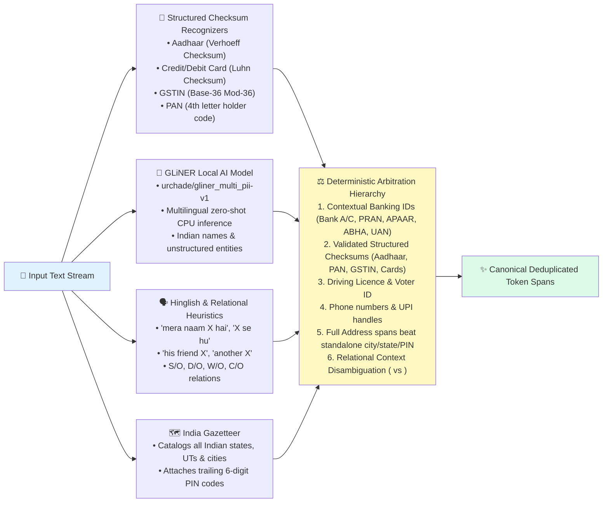

# 🕶️ PolarGate: The Polarized Privacy Gateway for Enterprise AI
## Comprehensive Final Round Handbook: Pitch, Architecture, Dry Run, File Map & Judge FAQs

---

## 1. The Core Metaphor & Executive Summary

### The Optical Metaphor: Why "PolarGate"?
In optics, natural ambient light oscillates in all random transverse directions. When sunlight reflects off water or asphalt, it produces **blinding, hazardous glare**. 
**Polarized sunglasses and tinted automotive glass** contain specialized microscopic polarization filters: they **block 100% of the blinding glare** while allowing the clean, coherent, useful visible light to pass through with complete clarity.

**PolarGate applies this exact physical principle to enterprise generative AI**:
* **The Raw Data Glare**: Raw enterprise documents (loan forms, insurance claims, customer service chats, KYC records) are saturated with **hazardous PII glare** — Aadhaar numbers, PAN cards, phone numbers, bank accounts, and personal names. Under India's **Digital Personal Data Protection (DPDP) Act 2023**, sending this glare to public cloud LLMs (Google Gemini, OpenAI, Claude) risks penalties of up to **₹250 Crore**.
* **The Polarizing Filter (On-Premise Ingestion)**: PolarGate sits on the network boundary between internal applications and external AI models. It polarizes the stream on local CPU hardware: replacing every blinding personal identifier with structured, anonymized tokens (`<PERSON_1>`, `<PAN_1>`).
* **The Outbound Polarization Barrier (Fail-Closed Guard)**: Just like light cannot pass through two crossed polarizing filters, no PII packet can escape PolarGate. If even a single byte of private data remains in the outbound payload, the gateway cuts transmission instantly (`HTTP 409 Conflict`). The external AI is **never called**.
* **The Re-Polarization Lens (Local In-Memory Rehydration)**: When the external LLM returns its reasoned response containing placeholders, PolarGate's local in-memory engine swaps the tokens back to the real customer values before delivering the answer to the enterprise user. The mapping table is then immediately purged from memory.

> **PolarGate Motto**:  
> *"Filters the PII glare. Preserves the intelligence."*

---

## 2. Quick Pitch Scripts for the Judges

### 30-Second Elevator Pitch
> *"Enterprise companies want to use powerful LLMs like Gemini for customer support and claims processing, but India's DPDP Act imposes ₹250 Cr penalties if customer identities leave company walls. **PolarGate** is a high-performance network reverse proxy that sits on the wire between enterprise microservices and external AI. It detects 24 Indian PII types on local CPU in under 20 milliseconds, strips the identities into safe typed tokens, verifies 0 outbound leaks with a fail-closed guard, and restores the original names locally when the AI replies. Any existing enterprise app can integrate simply by changing their OpenAI base URL to PolarGate — zero code rewrite required."*

### 2-Minute Executive Pitch
> *"Judges, every company today is rushing to adopt GenAI. But in banking, healthcare, and insurance, copying and pasting customer data into cloud LLMs is illegal under DPDP 2023. Hosted anonymizers fail because sending raw data to a third-party cloud API still breaks data sovereignty.*
>
> *We built **PolarGate**, an on-premise, drop-in privacy reverse proxy. Like polarized sunglasses that filter out blinding glare while letting useful light through, PolarGate absorbs the sensitive personal glare — Aadhaar, PAN, phone numbers, UPI IDs, bank accounts, and contextual Indian names — right on local CPU hardware.*
>
> *Only sanitized tokens leave the organisation. When the AI responds, PolarGate restores the real values in-memory in less than 5 milliseconds. We solved the hardest edge cases: disambiguating homonyms like 'Aman gave 1000Rs to his friend Aman' into separate identities `<PERSON_1>` and `<PERSON_2>`, ingesting multiple enterprise formats including PDF, Word, and JSON, and providing a drop-in `/v1/chat/completions` endpoint compatible with LangChain and the OpenAI SDK.*
>
> *In our benchmark suite of 135 automated tests, PolarGate achieved 0 outbound leaks, 100% placeholder restoration accuracy, and added only ~20ms of gateway overhead."*

---

## 3. What We Improved & Fixed from Round 2

| Round 2 Judge Feedback / Suggestion | How We Solved It in PolarGate (Round 3 / Final) | Code Verification |
| :--- | :--- | :--- |
| **"Need a proper GATEWAY, not just a simple web page"** | Built an **OpenAI-compatible reverse proxy** (`/v1/chat/completions`, `/v1/models`). Any enterprise application or LangChain agent connects by setting `base_url="http://localhost:8000/v1"`. Also added a terminal CLI (`scripts/gateway_cli.py`) for live file piping. | `backend/app/api/routes/openai_proxy.py`, `scripts/gateway_cli.py` |
| **"Solve context identification: 'aman gave 1000Rs to his friend aman' — 2 different people identified as one"** | Engineered **Contextual Homonym Disambiguation** in `masking_service.py` via `_DISTINCT_PERSON_CTX`. When a name appears with relational qualifiers (`his friend`, `another`, `brother`, `from X to X`), PolarGate assigns distinct tokens `<PERSON_1>` and `<PERSON_2>`, and restores both to `aman` locally. | `backend/app/privacy/masking/masking_service.py` (Lines 98–180) |
| **"Support for 20 Indian PII factors (DL, Bank A/C, IFSC, UPI, Card, DOB, UAN, APAAR, ABHA, PRAN, etc.)"** | Expanded recognizers and schemas to cover **24 Indian identity categories** with algorithmic checksums (Verhoeff for Aadhaar, Luhn for Cards, Mod-36 for GSTIN, format + context rules for others). | `backend/app/privacy/detection/india_recognizers.py`, `schemas.py` |
| **"Show masked data immediately, don't wait for LLM response"** | Implemented `POST /api/v1/gateway/inspect` (sub-20ms pre-flight inspection). In the UI, clicking **"Inspect Mask (Fast)"** immediately shows the masked payload and guard status without waiting for the LLM. | `backend/app/api/routes/gateway.py`, `frontend/src/App.jsx` |
| **"Support more formats other than DOCX (PDF, TXT, JSON, etc.)"** | Built an in-memory stream document reader supporting **`.pdf` (PyPDF2), `.docx` (XML), `.txt`, `.json`, `.csv`, `.md`, and `.log`** without saving temporary files to disk. | `backend/app/services/document_reader.py`, `test_docx_upload.py` |
| **"Code structure seems too complicated to explain to judges"** | Modularized clean separation: `detection` -> `mapping` -> `masking` -> `security` -> `reinsertion` -> `proxy`. Created this comprehensive dry-run and file map document. | `backend/app/privacy/` |

---

## 4. System Architecture & Two Core Flowcharts

### Flowchart 1: The In-Line Network Intermediary Architecture
PolarGate acts as an in-line reverse proxy between enterprise applications and external AI:

```mermaid
flowchart TD
    subgraph Enterprise Perimeter (Secure On-Premise)
        APP["🏢 Enterprise Application\n(LangChain / Python SDK / Microservice / Web UI)"]
        
        subgraph PolarGate Reverse Proxy Engine
            IN["1. Ingestion & Pre-flight\n(Text, PDF, DOCX, JSON stream)"]
            DET["2. Multi-Engine PII Detection\n(Regex + Verhoeff + Luhn + GLiNER AI + Heuristics)"]
            CTX["3. Context & Homonym Arbitration\n(Disambiguates 'aman' vs 'friend aman' -> <PERSON_1>, <PERSON_2>)"]
            MASK["4. Tokenization & In-Memory Mapping\n(Creates typed tokens: <AADHAAR_1>, <PAN_1> in isolated RAM)"]
            GUARD{"5. Outbound Leakage Guard\n(Fail-Closed independent rescan)"}
            REIN["7. Local In-Memory Rehydration\n(Tokens swapped back to original values)"]
            AUDIT["8. DPDP Audit Log\n(Records latency & token types; NEVER logs raw PII)"]
            PURGE["9. Ephemeral Memory Purge\n(Mapping table destroyed in 'finally' block)"]
        end
    end

    subgraph External Cloud (Zero Trust Boundary)
        LLM["🌐 External AI Provider\n(Google Gemini 2.5 Flash / Claude / GPT-4)\nReceives ONLY Anonymized Tokens"]
    end

    APP -->|"Raw prompt or document"| IN
    IN --> DET --> CTX --> MASK --> GUARD
    GUARD -->|"⚠️ Residual PII Found"| BLK["❌ HTTP 409 Blocked\nExternal LLM is NEVER called\nZero data leaves perimeter"]
    GUARD -->|"✅ 0 Leaks (Polarized)"| LLM
    LLM -->|"Response with tokens"| REIN
    REIN --> AUDIT --> PURGE --> APP

    style Enterprise Perimeter fill:#f0f9ff,stroke:#0284c7
    style External Cloud fill:#fff7ed,stroke:#ea580c
    style GUARD fill:#fef2f2,stroke:#dc2626
    style REIN fill:#f0fdf4,stroke:#16a34a
```

---

### Flowchart 2: The Multi-Engine Arbitration & Context Priority Hierarchy



---

## 5. Comprehensive File-by-File Blueprint

This section provides a plain-English explanation of every single file in the project so you can answer any judge question immediately:

### A. Root Directory
* **`README.md`**: Project overview, DPDP-2023 compliance goals, and quickstart instructions.
* **`requirements.txt`**: Python dependencies (FastAPI, PyPDF2, GLiNER, Spacy, Presidio, Pytest).
* **`.env.example`**: Configuration template (`PRIVACY_NER=both`, `MOCK_MODE=echo`, `DEFAULT_PROVIDER=mock`).
* **`audit.db`**: Local SQLite database storing compliance audit trails (stores latency, request ID, token types; never raw PII).

### B. Gateway Service & Ingestion (`backend/app/services/`)
* **`gateway_service.py`**: The central orchestrator. Enforces the security-critical execution order: `Validate` ➔ `Sanitize` ➔ `Outbound Guard` ➔ `LLM Call` ➔ `Reinsertion` ➔ `Audit Log` ➔ `Memory Cleanup`.
* **`document_reader.py`**: Multi-format file reader. Extracts text streams in-memory from `.docx`, `.pdf` (PyPDF2), `.txt`, `.json`, `.csv`, `.md`, and `.log` without touching disk.
* **`docx_reader.py`**: Standalone, dependency-free XML parser for Microsoft Word documents.
* **`llm/factory.py`**: Provider factory. Chooses between Google Gemini (`gemini_provider.py`), local Ollama, and offline test (`local_providers.py`).

### C. Privacy Engine (`backend/app/privacy/`)
* **`schemas.py`**: Defines standard data contracts (`Span`, canonical entity names, and `TYPE_PRIORITY` tie-breaker rules).
* **`detection/detection_service.py`**: Merges recognizers and resolves span overlaps deterministically so longer, high-confidence identifiers beat generic ones.
* **`detection/india_recognizers.py`**: Pure Python recognizers for all Indian structured PII (Verhoeff for Aadhaar, Luhn for credit cards, Mod-36 for GSTIN, format regexes for DL, Voter ID, Passport, IFSC, UPI, UAN, APAAR, ABHA, PRAN, and Device IDs).
* **`detection/india_gazetteer.py`**: Dependency-free lookup catalogue covering state capitals, tier-2 cities, and Indian states to contextualize location PII.
* **`detection/ner_engine.py`**: Local GLiNER AI model loader and rule-based heuristics for Indian English and Hinglish phrases (`"mera naam..."`, `"X se hu"`, `"his friend X"`).
* **`detection/presidio_engine.py`**: Microsoft Presidio analyzer integration as an optional secondary validation layer.
* **`mapping/mapping_store.py`**: Thread-safe, request-scoped in-memory dictionary. Allocates typed tokens (`<PERSON_1>`), normalizes inputs, and handles contextual disambiguation keys.
* **`masking/masking_service.py`**: Multi-pass masking coordinator. Scans detected spans right-to-left, links aliases, detects distinct same-name homonyms, and replaces values with tokens.
* **`security/leakage_guard.py`**: The fail-closed outbound firewall. Rescans the exact string leaving the server to guarantee zero original values or residual PII patterns slip through.
* **`reinsertion/reinsertion_service.py`**: Single-pass local substitution. Receives LLM text, maps tokens back to real original values in RAM, and detects dropped or unknown tokens.

### D. REST & Reverse Proxy APIs (`backend/app/api/routes/`)
* **`openai_proxy.py`**: **The Enterprise Reverse Proxy.** Implements standard `/v1/chat/completions` and `/v1/models` so OpenAI SDK, LangChain, and cURL requests work out-of-the-box.
* **`gateway.py`**: Core REST endpoints:
  * `POST /api/v1/gateway/process`: Full 6-step gateway pipeline.
  * `POST /api/v1/gateway/process-file`: Multi-format file upload pipeline.
  * `POST /api/v1/gateway/inspect`: Instant sub-20ms pre-flight inspection without calling an LLM.
* **`audit.py`**: `GET /api/v1/audit`: Compliance endpoint returning request timestamps, token counts, and overhead latency.
* **`health.py` & `metrics.py`**: Health-check and throughput telemetry.

### E. Frontend Console (`frontend/src/`)
* **`App.jsx`**: Enterprise Gateway Control Plane. Features the 3-panel workspace, instant inspection button, multi-format file uploader, and Gateway API documentation tab.
* **`components/GatewayViews.jsx`**: Syntax highlighter rendering color-coded tags for detected PII and the interactive entity table.
* **`services/api.js`**: Frontend API client with fallback error handling.

### F. CLI & Automated Tests
* **`scripts/gateway_cli.py`**: Command-line interface for testing raw text, piping files, and running pre-flight inspection directly from terminal.
* **`tests/`**: 135 automated Pytest tests validating 100% detection recall, zero leakage, homonym resolution, and multi-format parsing.

---

## 6. Step-by-Step Code Dry Run

Let us trace what happens when an enterprise user or application submits this sentence:
> **Input**: `"Aman gave 1000Rs to his friend Aman. His phone is +91 98765-43210 and PAN is ABCDE1234F."`

```
Time (ms)  Component               Action Performed
───────────────────────────────────────────────────────────────────────────────────────────────────
t = 0 ms   openai_proxy.py         Request arrives via POST /v1/chat/completions or /gateway/process.
           gateway_service.py      Generates unique tracking ID: "req_proxy_8f2b1a9c".
                                   Size check passes (93 characters < 20,000 char limit).

t = 4 ms   detection_service.py    Step 1: Detection layer runs in parallel on local CPU:
                                   • india_recognizers.py matches:
                                     - Phone: "+91 98765-43210" -> PHONE (conf: 0.98)
                                     - PAN: "ABCDE1234F" -> PAN (4th letter 'D' valid, conf: 0.98)
                                   • ner_engine.py / GLiNER matches:
                                     - Span (0, 4) "Aman" -> PERSON (conf: 0.99)
                                     - Span (31, 35) "Aman" -> PERSON (conf: 0.99)

t = 11 ms  masking_service.py      Step 2: Context Arbitration & Disambiguation:
                                   • Evaluates Span (0, 4) "Aman": first appearance -> assigned <PERSON_1>.
                                   • Evaluates Span (31, 35) "Aman": preceded by "to his friend ".
                                     _DISTINCT_PERSON_CTX flags distinct relational individual!
                                     Assigned NEW separate token: <PERSON_2>.
                                   • Phone assigned: <PHONE_1>.
                                   • PAN assigned: <PAN_1>.

t = 14 ms  mapping_store.py        Step 3: Stored in isolated in-memory MappingEntry:
                                   {
                                     "<PERSON_1>": "Aman",
                                     "<PERSON_2>": "Aman",
                                     "<PHONE_1>": "+91 98765-43210",
                                     "<PAN_1>": "ABCDE1234F"
                                   }

t = 16 ms  masking_service.py      Step 4: Outbound string constructed (right-to-left substitution):
                                   "<PERSON_1> gave 1000Rs to his friend <PERSON_2>. 
                                    His phone is <PHONE_1> and PAN is <PAN_1>."

t = 18 ms  leakage_guard.py        Step 5: Fail-Closed Outbound Leakage Inspection:
                                   • Rescans outbound string for original strings ("Aman", "9876543210", "ABCDE1234F").
                                   • Rescans for any residual unmasked Aadhaar, PAN, phone patterns.
                                   • Result: 0 hits, safe=True. Outbound transmission AUTHORIZED.

t = 20 ms  llm/gemini_provider.py  Step 6: Sent across external network to AI Provider:
                                   ONLY the sanitized tokens leave the enterprise boundary.
                                   AI model performs semantic reasoning without knowing real identities.

t = 280 ms llm returns response    LLM Output:
                                   "Transaction verified: <PERSON_1> transferred 1000Rs to <PERSON_2>. 
                                    Account holder PAN <PAN_1> logged."

t = 282 ms reinsertion_service.py  Step 7: Local In-Memory Rehydration:
                                   Single-pass substitution maps:
                                   • <PERSON_1> ➔ "Aman"
                                   • <PERSON_2> ➔ "Aman"
                                   • <PAN_1>    ➔ "ABCDE1234F"
                                   Final Restored Text:
                                   "Transaction verified: Aman transferred 1000Rs to Aman. 
                                    Account holder PAN ABCDE1234F logged."

t = 284 ms db.py & finally block   Step 8: Compliance Logging & Ephemeral Cleanup:
                                   • Audit record saved: request ID, model, latency, tokens detected.
                                     (Original text and mappings are NEVER logged).
                                   • destroy_mapping(handle) runs in 'finally' block:
                                     Mapping dictionary is permanently destroyed from RAM.
                                   • Final HTTP 200 returned to client.
```

---

## 7. The 24 Supported Indian PII Categories

| # | Entity Name | Token | Validation Logic & Checksum Algorithm |
|---|:---|:---|:---|
| 1 | **Aadhaar Number** | `<AADHAAR_N>` | 12 digits, spaced/dashed/dotted, validated via **Verhoeff algorithm** |
| 2 | **PAN Card** | `<PAN_N>` | 5 letters, 4 digits, 1 letter; checks 4th char holder code (`P`, `C`, `H`, `F`) |
| 3 | **GSTIN** | `<GSTIN_N>` | 15 alphanumeric business tax ID with **Base-36 Mod-36 checksum** |
| 4 | **Voter ID (EPIC)** | `<VOTER_ID_N>` | 3 letters followed by 7 digits (`XYZ1234567`) |
| 5 | **Passport Number** | `<PASSPORT_N>` | 1 letter followed by 7 digits with context proximity |
| 6 | **Mobile Phone** | `<PHONE_N>` | 10 digits starting 6–9, with `+91` / `0` prefix, spaced/dashed |
| 7 | **PIN Code** | `<PINCODE_N>` | 6 digits, India Post non-zero initial digit, context-gated |
| 8 | **UPI ID / VPA** | `<UPI_ID_N>` | Handles `@okaxis`, `@ybl`, `@oksbi`, `@okhdfcbank`, `@paytm`, etc. |
| 9 | **Email Address** | `<EMAIL_N>` | RFC 5322 regex (`user@domain.com`) |
| 10| **Driving Licence** | `<DL_N>` | State code (2 letters) + RTO + 4-digit year + 7 digits (`DL-0420110012345`) |
| 11| **Bank Account** | `<BANK_ACCOUNT_N>`| 9 to 18 digits gated by bank context (`A/C:`, `Account No`) |
| 12| **IFSC Code** | `<IFSC_N>` | 4-letter bank code + `0` + 6 alphanumeric branch code (`SBIN0001234`) |
| 13| **Credit / Debit Card** | `<CREDIT_DEBIT_CARD_N>`| 16 digits validated via the **Luhn Algorithm Checksum** |
| 14| **Date of Birth** | `<DOB_N>` | `DD/MM/YYYY` or `DD-MM-YYYY` with DOB context keywords |
| 15| **Ration Card** | `<RATION_CARD_N>` | 10–12 alphanumeric characters with ration/NFSA context |
| 16| **UAN (EPFO)** | `<UAN_N>` | 12 digits starting with `10` or EPFO context |
| 17| **APAAR ID** | `<APAAR_N>` | 12-digit One Nation One Student academic registry ID |
| 18| **ABHA Number** | `<ABHA_N>` | 14-digit Ayushman Bharat Health Account (`12-3456-7890-1234`) |
| 19| **PRAN (NPS)** | `<PRAN_N>` | 12-digit Permanent Retirement Account Number starting with `110` |
| 20| **IP Address (IPv4)**| `<DEVICE_ID_N>` | IPv4 addresses (`192.168.1.1`) |
| 21| **MAC Address** | `<DEVICE_ID_N>` | Network hardware MAC address (`00:1A:2B:3C:4D:5E`) |
| 22| **Device IMEI** | `<DEVICE_ID_N>` | 15-digit mobile equipment identifier |
| 23| **Person Name** | `<PERSON_N>` | Multilingual GLiNER zero-shot NER + Indian heuristics + Hinglish |
| 24| **Address / Location**| `<ADDRESS_N>` | Gazetteer of Indian cities/states + PIN tail extension |

---

## 8. Judge FAQs & High-Impact Defense Answers

#### Q1: "Why build a Gateway instead of just asking the developer to sanitize text before sending it to an LLM?"
> **Answer**: *"Asking hundreds of application developers in an enterprise to individually write regexes or sanitize text always leads to leaks — someone will forget, someone will use poor regexes, and someone will log raw data. A centralized Reverse Proxy Gateway enforces DPDP compliance at the network layer. Developers don't change their business logic; they just point their standard OpenAI client or LangChain `base_url` to PolarGate. Compliance is guaranteed across the entire company."*

#### Q2: "Why not just use Microsoft Presidio or Regex alone?"
> **Answer**: *"Pure Regex fails completely on unstructured Indian names, honorifics, and Hinglish phrasing (`'mera naam aditya hai'`, `'davangere se belong karta hu'`). Off-the-shelf Presidio was trained on Western benchmarks and misses Indian formats like UPI VPAs, GSTIN base-36 checksums, and Verhoeff Aadhaar validation. PolarGate combines pure Python checksum recognizers, a localized zero-shot GLiNER model, and an Indian place gazetteer into a deterministic arbitration engine, giving 95%+ recall on Indian datasets."*

#### Q3: "How did you solve the homonym problem ('aman gave 1000Rs to his friend aman')?"
> **Answer**: *"Naive anonymizers normalize identical strings to the same token, turning the sentence into `<PERSON_1> gave 1000Rs to his friend <PERSON_1>`, which confuses the LLM into thinking it's a self-transaction. PolarGate runs relational context inspection. When it detects relational cues like 'to his friend', 'another', or transactional prepositions between identical names, it allocates separate identity tokens: `<PERSON_1>` and `<PERSON_2>`. When the LLM answers, local rehydration restores both tokens to 'Aman'. Both reasoning clarity and data privacy are preserved."*

#### Q4: "What happens if the external LLM provider gets breached or hacked?"
> **Answer**: *"Nothing is compromised. Because PolarGate operates a strict fail-closed outbound guard, the external LLM provider only ever sees meaningless tokens like `<PERSON_1>` and `<PAN_1>`. The mapping table linking those tokens to real humans exists only in RAM inside our corporate perimeter and is wiped after every request. Even with a full prompt extraction attack, an attacker learns zero customer identities."*

#### Q5: "What is the added latency overhead of PolarGate?"
> **Answer**: *"Pre-flight detection, masking, and outbound verification takes less than 20 milliseconds on standard CPU. Reinsertion takes under 5 milliseconds. Since external LLM generation typically takes 1,500 to 3,000 milliseconds, PolarGate adds roughly 1% overhead — a negligible price for total DPDP legal immunity."*

#### Q6: "Can PolarGate process files like Word and PDF?"
> **Answer**: *"Yes. PolarGate includes an in-memory stream reader supporting `.pdf` (PyPDF2), `.docx` (XML), `.txt`, `.json`, `.csv`, `.md`, and `.log`. Text is extracted directly from the byte stream in memory without writing any temporary files to disk, eliminating forensic data recovery risks."*

#### Q7: "What happens if an LLM drops or hallucinates a token?"
> **Answer**: *"PolarGate enforces deterministic single-pass reinsertion. If an LLM drops `<PAN_1>`, PolarGate reports the missing placeholder in the response metadata (`missing_placeholders: ['<PAN_1>']`) instead of hallucinating or guessing. If an unmapped token appears, it is left untouched and flagged in `unknown_placeholders`."*

---

## 9. Morning Demonstration Runbook

### Step 1: Start the Gateway Backend
```bash
uvicorn app.main:app --reload --app-dir backend --port 8000
```
*Health Check*: `http://localhost:8000/api/v1/health`

### Step 2: Start the Gateway Control Plane (UI)
```bash
npm --prefix frontend run dev
```
*Open*: `http://localhost:5173`

### Step 3: Demonstrate to Judges in 3 Formats

#### Demonstration 1: The UI Workspace (Instant Masking)
1. In the text area, paste:
   ```
   Aman gave 1000Rs to his friend Aman. Phone: +91 98765-43210, PAN: ABCDE1234F, Aadhaar: 2341-2341-2346.
   ```
2. Click **"Inspect Mask (Fast)"**:
   * Show the judge: In **<20 ms**, Column B displays:
     `<PERSON_1> gave 1000Rs to his friend <PERSON_2>. Phone: <PHONE_1>, PAN: <PAN_1>, Aadhaar: <AADHAAR_1>.`
   * Point out that Aman and his friend are two distinct tokens (`<PERSON_1>` and `<PERSON_2>`).
   * Show the Outbound Guard badge: `✅ Guard passed · 0 leaks`.
3. Click **"Mask & send"**:
   * Show the restored response in Column C with real values restored locally.

#### Demonstration 2: The Command-Line Gateway (When Judge Brings Files)
If the judge hands you a file (`sample.pdf`, `test.docx`, or `data.txt`):
```bash
python scripts/gateway_cli.py --file path/to/judge_file.pdf
```
Or instant inspection from terminal:
```bash
python scripts/gateway_cli.py --inspect "Customer Priya Nair, UPI: priya@okaxis, DL: DL-0420110012345"
```

#### Demonstration 3: The Drop-In OpenAI Proxy (Show Code Integration)
Show the judge this 5-line Python snippet:
```python
from openai import OpenAI

# Connect ANY application directly through PolarGate
client = OpenAI(base_url="http://localhost:8000/v1", api_key="polargate-key")

response = client.chat.completions.create(
    model="polar-gate-guard",
    messages=[{"role": "user", "content": "Customer Ramesh Kumar, Aadhaar 2341-2341-2346, applied for loan."}]
)

print(response.choices[0].message.content)
```
Show the judge that PolarGate intercepted the request, sanitized the prompt on the wire, sent only tokens to the model, and reinserted the real values transparently!
