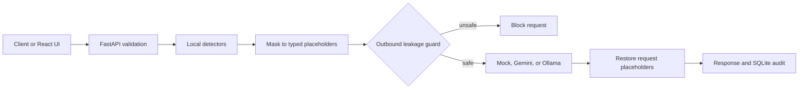

# MineArena PS-02 — Current System Status

**Status checked:** 12 November 2026  
**Branch:** `feature/backend-gateway`  
**HEAD:** `d8775e0` — `integrated GLiNER with MS Presidio`  
**Working tree:** clean when this document was prepared.

This file describes what is present in this repository and distinguishes automated checks from integrations that still need to be run on the deployment machine.

## System summary

MineArena is a FastAPI privacy gateway. It detects sensitive text locally, substitutes request-scoped placeholders, checks the exact provider payload for leaks, sends the sanitized content to a selected LLM provider, restores known placeholders from that request, and records audit metadata in SQLite.



## What is implemented

### Backend and privacy gateway

- FastAPI routes exist for health, gateway processing, audit records, and metrics.
- Gateway order is validation → detect and mask → validate exact outbound payload → provider call → reinsertion → audit → destroy request mapping.
- The provider receives sanitized text only. A rejected payload is blocked before the provider call.
- Mock, Gemini, and Ollama provider implementations are present. Optional fallback can be configured.
- Typed placeholders are request-scoped; only placeholders found in that request's mapping are restored.
- SQLite audit and metrics code is present.

### Detection

- **Yes, the enabled model-based path uses Presidio + GLiNER.** Presidio's registry contains the existing India ID recognizers and an additive GLiNER custom recognizer. The existing heuristic and regex detectors continue to run.
- Enable this path with `PRIVACY_USE_PRESIDIO=1` and `PRIVACY_NER=both`. The app warms the Presidio analyzer and GLiNER singleton during startup when Presidio is enabled.
- Existing heuristic name detection includes lowercase names in supported contexts, such as “my name is rahul sharma”. This does not guarantee detection of arbitrary names with no context.
- India-specific regexes cover Aadhaar, PAN, GSTIN, voter ID, and passport patterns. Email and Indian mobile number regexes were added as well.
- GLiNER entity labels map to `PERSON`, `ORGANIZATION`, `LOCATION`, `ADDRESS`, `EMAIL_ADDRESS`, and `PHONE_NUMBER`; regexes also detect email and Indian mobile values without relying on the model.
- New entity types use the existing mapping, masking, leakage guard, and reinsertion pipeline. No API endpoint was added or changed.
- GLiNER initialization and inference errors are caught so the other detectors can continue.
- This is a local NER approach, not GraphRAG. GLiNER is model-based; GraphRAG is not used in this masking pipeline.

### Frontend

- A React/Vite UI scaffold is present in `frontend/`, including document processing, sanitization, PII, LLM response, dashboard, and audit pages.
- Its API client targets `http://localhost:8000/api/v1` by default and can be configured with `VITE_API_BASE_URL`.
- Frontend build and live browser integration have **not** been verified in this status check.

## API surface

- `GET /api/v1/health`
- `POST /api/v1/gateway/process`
- `GET /api/v1/audit`
- `GET /api/v1/audit/{request_id}`
- `GET /api/v1/metrics`

The processing request accepts `text`, `task` (`summarize` or `extract`), and `provider` (`mock`, `gemini`, or `ollama`). The response includes sanitized/outbound text, detected entities, provider and timing metadata, leakage status, final response, and placeholder reinsertion results. The in-memory original-to-placeholder mapping is not returned.

## Verification

**Verified in this workspace:**

- `PYTHONPATH=backend /tmp/minearena-venv/bin/pytest tests -q` → **59 passed**, 11 dependency deprecation warnings.
- `git diff --check` passed when the implementation changes were prepared.
- New offline tests use fake GLiNER predictions. They cover Presidio registry registration, offsets/confidence, combined regex and model detection, and inference failure fallback.
- No package was installed and no model weights were downloaded for this implementation.

**Not verified here:**

- Loading the actual GLiNER model weights or measuring its CPU startup/inference time.
- Running Presidio with the configured `en_core_web_sm` spaCy model.
- Live Gemini API calls or Ollama service calls.
- Frontend build/browser integration.
- Measured precision, recall, F1, leakage rate, or end-to-end latency against Member 3's evaluation dataset.

Passing offline tests verifies code paths and contracts; it does not establish live model quality or complete PII recall.

## Dependencies and run configuration

Root `requirements.txt` lists FastAPI, Uvicorn, Pydantic, HTTPX, python-dotenv, Presidio Analyzer, spaCy, GLiNER, and pytest. GLiNER's PyTorch/Transformers runtime comes in as package dependencies. The target machine also needs the spaCy model configured by `SPACY_MODEL` and access to the configured GLiNER weights. This workspace intentionally did not install these dependencies for this work.

The example configuration in `.env.example` enables Presidio and `PRIVACY_NER=both`, and names the spaCy and GLiNER models. Keep real credentials in a local `.env`, never in Git. A simple startup sequence on the target machine is:

```bash
python3 -m venv .venv
source .venv/bin/activate
pip install -r requirements.txt
python -m spacy download en_core_web_sm
cp .env.example .env
# Add GEMINI_API_KEY only if testing Gemini.
uvicorn app.main:app --reload --app-dir backend
```

Start with the `mock` provider for an offline API demo. Install frontend packages and run its Vite dev server in a second terminal only on the machine where the UI will be tested.

## Remaining work

1. On the deployment PC, install the declared packages and spaCy model; verify GLiNER weights are available locally.
2. Start the API with `PRIVACY_USE_PRESIDIO=1` and `PRIVACY_NER=both`; confirm startup, health, and synthetic person/organization/location/email/phone requests.
3. Smoke test mock mode, then Gemini with a valid key; test Ollama only if the service/model will be used. Keep secrets out of the repository.
4. Build and connect the React UI to the running API.
5. Run Member 3's synthetic dataset evaluation and record per-entity precision/recall, reinsertion accuracy, outbound leakage, and latency. Do not claim measured results before this run.
6. Review any detector misses and false positives; improve detection based on evaluation evidence. Name and location detection can still miss cases, particularly when names have no identifying context.

## Round 1 explanation for judges

> “We replace sensitive values with labels before sending text to the model. A local check blocks unsafe output. After the model replies, we restore only labels from that request. The audit records the sanitized payload and request metadata.”

For a simple demo: use synthetic text, call health, submit a mock request, show the labels in the outbound payload, then inspect audit and metrics. GLiNER/Presidio and live provider results should be described as tested only after they have been exercised on the target machine.

## Ownership handoff

- **Member 1 (Abhay):** backend routes, gateway orchestration, provider adapters, errors/configuration, SQLite audit, and integration.
- **Member 2:** local privacy detection/masking; now includes the GLiNER + Presidio recognizer integration and synthetic regression tests.
- **Member 3:** finish frontend/API integration as needed, prepare the synthetic evaluation set, and report measured detection, leakage, reinsertion, and latency results.

