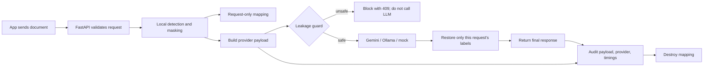
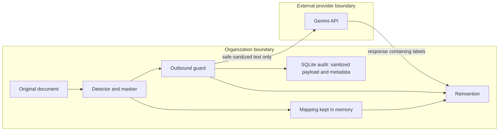

# MineArena PS-02 — Team Handoff and Round 1 Runbook

Use this file as the short context packet for teammates and future models. The full technical references are the Abhay team architecture document and `MineArena_PS02_Master_Guide_1.md`; this file records the decisions and current workspace status.

## Source of truth and status

1. **Architecture/API/ownership:** `MineArena_Team_Architecture_and_ImplementationAbhay.md`.
2. **Implementation clarifications, Round 1 scenarios, and evaluation definitions:** `MineArena_PS02_Master_Guide_1.md`.
3. **Starter code:** contents of `minearena_code.zip`, copied into this workspace.

The archive's contents are starter code, not proof of a working deployment. **[TESTED]** The current workspace suite passes: 43 tests using Python 3.14.4, FastAPI 0.115.14, pytest 9.2.0. **[TESTED]** FastAPI lifespan/startup, health, the Member 3 HTTP contract, CORS preflight, safe validation errors, blocked-request response/audit, mock processing for the basic, Hinglish, repeated-name, and dropped-placeholder examples, audit, and metrics passed with heuristic detection. Gemini, GLiNER model loading, Presidio with its spaCy model, Ollama, and the real external provider path remain **[UNTESTED]**. The guide's earlier 37/38-test counts referred to earlier snapshots. Do not report performance numbers before the dataset evaluation runs.

Current shared repository branch for Abhay's work: `feature/backend-gateway`, created from `origin/main`. Member 3 should branch from or pull this branch once it is pushed.

### Update: branch `feature/robust-detection-eval` (12 Nov)

The status paragraph above is out of date.

- **Silent GLiNER fallback found and fixed.**
  - GLiNER had been failing to load (missing `sentencepiece`/`protobuf`), and the code hid the error. Every request had been running on regex rules alone.
  - With the model loaded, the label `"person name"` returned no entities at all; the labels are now `person`/`address`/`location`.
  - A live Gemini run had leaked a shared surname ("Nair") and given one person two placeholders. Both are fixed and covered by regression tests.
- **[TESTED]** `pytest tests -q` passes 59 tests; the real-model GLiNER and Presidio tests pass 8 (Python 3.12, presidio-analyzer 2.2.366, gliner 0.2.30).
- **[TESTED]** Live Gemini `gemini-2.5-flash` path: 7 of 10 evaluation requests succeeded, the other 3 were provider errors (probably rate limiting).
- **[UNTESTED]** Ollama.
- **New endpoints** (additive; frozen contracts unchanged):
  - `GET /api/v1/engines`: status of each detection layer, including the reason for any failure.
  - `GET /api/v1/evaluation`: the latest `evaluation/results.json`.
- **Behaviour change** in `test_ambiguous_token_not_merged_across_people`: a name token shared by two people (e.g. a lone "Rahul") is now masked with its own placeholder. It was previously left in clear text.
- **Dataset and evaluation:** generated by `dataset/` and `evaluation/`; numbers are in `evaluation/results.md` and the README. The main set was used for error analysis, so quote the **held-out** numbers.
- **UI:** three side-by-side columns (original · exact outbound payload with entity table · final response), a blocked-request banner, and an Evaluation tab.

## Frozen interface

- **Privacy module:** Member 1 imports only `sanitize_document(text, request_id)`, `validate_outbound_payload(payload, mapping_handle)`, `reinsert_placeholders(llm_response, mapping_handle)`, and `destroy_mapping(mapping_handle)` from `app.privacy`. Sanitization returns `sanitized_text`, `entities`, `mapping_handle`, and `leakage_check` (`true` means the initial check passed); validation returns `safe`, `leakage_count`, and PII-free findings; reinsertion returns `restored_text`, restored/missing/unknown placeholders. Destroy the mapping in `finally`. These functions are synchronous; call them with `asyncio.to_thread` from the async gateway.
- **Request:** `POST /api/v1/gateway/process` with `{"text": string, "task": "summarize"|"extract", "provider": "gemini"|"ollama"|"mock"}`. The server creates the request ID.
- **Other routes:** `GET /api/v1/health`, `/api/v1/audit`, `/api/v1/audit/{request_id}`, `/api/v1/metrics`.
- **Success response:** includes `request_id`, `status`, `original_text`, `sanitized_text`, `outbound_payload`, `entities` (offsets into original text), `llm_response`, `final_response`, `provider`, `model`, `fallback_used`, `leakage_detected`, `leakage_count`, `processing_time_ms`, `llm_time_ms`, `gateway_overhead_ms`, `missing_placeholders`, and `unknown_placeholders`. Never include the local mapping or its handle.
- **Error response:** `{"error":{"code":"...","message":"...","request_id":"...|null","details":{}}}`. Stable codes/statuses: `INVALID_REQUEST` 400, `INPUT_TOO_LARGE` 413, `PII_PROCESSING_FAILED` 422, `LLM_PROVIDER_ERROR` 502, `LLM_PROVIDER_TIMEOUT` 504, `REINSERTION_FAILED` 500, `PRIVACY_ENGINE_UNAVAILABLE` 503, `OUTBOUND_PII_LEAKAGE_BLOCKED` 409, `INTERNAL_ERROR` 500. Messages/details must never contain PII or secrets.
- **Canonical entity labels:** `PERSON`, `AADHAAR`, `PAN`, `GSTIN`, `VOTER_ID`, `PASSPORT`, `ADDRESS`; placeholders are `<TYPE_N>`.

## Project in plain language

MineArena is a privacy gateway between an organization's app and an LLM. It detects sensitive values locally, replaces them with typed labels, checks the exact candidate payload, sends only sanitized text to the provider, restores labels from this request locally, and audits the request. The original-to-label mapping stays local and is destroyed after processing.



## Trust boundary



For a blocked request, the audit records status and safe finding metadata but stores `sanitized_payload: null`, because the rejected candidate might contain raw PII and was never sent. For successful requests, the audit stores the exact payload built by the selected provider.

## Detection choice: graph or transformer?

Use local GLiNER NER (a model-based span detector) for names and addresses, plus rule/context patterns and India-specific ID recognizers; Presidio orchestrates/customizes detection when enabled. **Do not use GraphRAG**: it is for graph-based retrieval, does not provide the masking spans this pipeline needs, and may make its own LLM calls. ModernBERT fine-tuning is a later option only if measured name/address recall is weak. No training or graph method is required for Round 1.

## Abhay (Member 1): next steps

- Own `backend/app/main.py`, `backend/app/api/`, `backend/app/core/`, `backend/app/services/`, `backend/app/database/`, plus root setup/docs. Keep Member 2's `backend/app/privacy/` and `tests/privacy/` under their ownership.
- Keep API paths, entity names, `<TYPE_N>` placeholders, the four privacy functions, and common error shape from the architecture document. The guide's additions are `outbound_payload`, `llm_time_ms`, `gateway_overhead_ms`, and `fallback_used`.
- Keep the order security-critical: validate → sanitize in a worker thread → build exact provider payload → guard it → call provider with sanitized text only → reinsert locally → audit → destroy mapping in `finally`.
- Keep `.env` and credentials out of version control. The example config leaves fallback empty so Gemini failures are visible; set `LLM_FALLBACK=mock` or `ollama` only when intentionally demonstrating fallback.
- A successful audit record should contain the exact outbound payload, actual provider/model, entity types, status, leakage/missing counts, timings, and error code. Never store raw original values or mappings.

## Round 1 runbook (backend demo, about 90 minutes)

### Setup and checks

```bash
python3 -m venv .venv
source .venv/bin/activate
pip install -r requirements.txt
python -m spacy download en_core_web_sm
pytest tests -q
cp .env.example .env
# Put GEMINI_API_KEY in .env only if testing Gemini; never commit .env.
uvicorn app.main:app --reload --app-dir backend
```

In a second terminal, verify `curl -s localhost:8000/api/v1/health`. Start with provider `mock`; then verify Gemini using a valid key/model. Before the venue, pre-load GLiNER weights by setting `PRIVACY_NER=both` and running the probe described in the master guide. Keep honest labels: fallback, live Gemini, GLiNER, and Presidio counts are only **[TESTED]** after they work in the current environment.

To warm up the local name/address model before the venue:

```bash
PRIVACY_NER=both PYTHONPATH=backend python3 -c 'from app.privacy.detection.ner_engine import get_gliner; print(get_gliner())'
python3 -m spacy download en_core_web_sm
```

### Demo order

1. **Basic judge example:** POST a synthetic name, Aadhaar-shaped value, and PAN using provider `mock`; point out `<PERSON_1>`, `<AADHAAR_1>`, `<PAN_1>` in `sanitized_text` and the exact guarded `outbound_payload`.
2. **Hinglish:** run the “Mera naam … hai / Pune mein rehta hai” example; the heuristic-only smoke check masked the example's name, Pune, and PAN. Be candid about any misses on new examples.
3. **Repeated entity:** use a labeled first occurrence such as `Applicant: Rahul Sharma ... Rahul Sharma ...` and show each occurrence reuses the same placeholder. This works with the rule-based fallback as well as GLiNER.
4. **LLM behavior:** restart with `MOCK_MODE=drop` (or `reorder`); show missing placeholders are reported and dropped values are not guessed back into the response.
5. **Audit and metrics:** call `GET /api/v1/audit` and `GET /api/v1/metrics`; show the payload, model, latency, and leakage total.
6. **Blocked leak:** run `pytest tests/backend/test_gateway.py::test_leak_blocks_llm_call -q`; explain that the provider was never called and the rejected candidate was not written to the audit.

Copy-paste demo requests (all use synthetic values):

```bash
U=http://localhost:8000/api/v1/gateway/process
H='Content-Type: application/json'
# D1: basic judge example
curl -s "$U" -H "$H" -d '{"text":"My name is Rahul Sharma. My Aadhaar number is 1234-5678-9012 and my PAN is ABCDE1234F.","task":"summarize","provider":"mock"}'
# D2: Hinglish
curl -s "$U" -H "$H" -d '{"text":"Mera naam Rahul Sharma hai. Main Pune mein rehta hoon. Mera PAN ABCDE1234F hai.","task":"extract","provider":"mock"}'
# D3: same person repeated; same placeholder each time
curl -s "$U" -H "$H" -d '{"text":"Applicant: Rahul Sharma applied for a loan. Rahul Sharma lives in Pune. Rahul Sharma submitted PAN ABCDE1234F.","task":"summarize","provider":"mock"}'
# D4: set MOCK_MODE=drop before starting uvicorn; the response reports missing labels
# D5: inspect exact successful outbound payload and aggregate metrics
curl -s http://localhost:8000/api/v1/audit
curl -s http://localhost:8000/api/v1/metrics
```

For the blocked-leak proof, run `pytest tests/backend/test_gateway.py::test_leak_blocks_llm_call -q`; this sabotages the masker in a test and asserts that the provider is never called. For the drop/reorder cases, the offline suite covers `MOCK_MODE=drop`, `reorder`, `paraphrase`, and `unknown`.

Do not use real identity information in any demo.

## What to tell the judges

> “We replace sensitive values with labels before sending text to the model. A local check blocks unsafe output. After the model replies, we restore only labels from that request. The audit records what was sent without storing the original values.”

Useful supporting points:

- “Here is the exact payload that passed the guard and went to the provider.”
- “If the model drops a label, we report it; we do not invent a replacement.”
- “The detector runs locally. Structured IDs use India-specific recognizers; names and addresses use local NER and context rules.”
- Do not claim perfect recall or DPDP compliance. Missed free-text names/addresses are a known risk; report measured results.

## Team handoffs

- **Member 2 — privacy engine:** install and probe GLiNER on synthetic Indian-English/Hinglish examples; check the Presidio-enabled path; report top missed patterns; add regression coverage only within `backend/app/privacy/` and `tests/privacy/`.
- **Member 3 — frontend/data/evaluation:** independently build the three-panel UI, generate about 50 synthetic documents with programmatic entity spans, and calculate per-type strict/relaxed precision/recall/F1, reinsertion accuracy, leakage, and added latency. Use mock responses until backend is available.
- **Shared:** use only synthetic data, preserve the public contracts, and label evidence as tested/unverified. Do not add EMAIL/PHONE or change entity/response names without team agreement.

### Evaluation definitions for Member 3

- Detection: report strict exact-span/type and relaxed same-type overlap (IoU ≥ 0.5) precision/recall/F1 by entity type; name the headline metric.
- Reinsertion: correctly restored placeholders present in the LLM reply divided by expected restorable placeholders. Report dropped placeholders separately; wrong-person restoration must be zero.
- Leakage: ground-truth PII values found in the audited outbound payload; target zero.
- Added latency: mean and median `gateway_overhead_ms`, sample count, compared with direct-LLM calls on the same documents.

## Continuation prompt for another model

```text
Read only docs/GUIDE.md and the specific source files needed for the next task. Follow the ownership and API contract stated there. Do not edit backend/app/privacy/ unless assigned to Member 2. Never log or commit raw PII, mappings, or keys. Use synthetic examples. Run only the named checks, report exact pass/fail output, and mark Gemini/GLiNER/Presidio/Ollama as unverified unless actually exercised. Keep the response concise: files changed, verification, unresolved risks.
```
